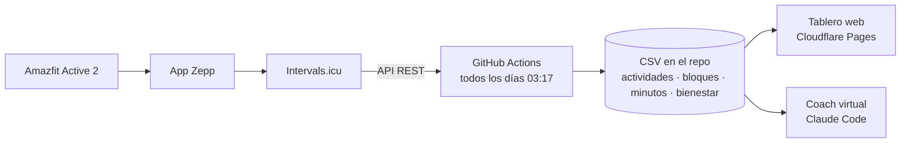

# Entrenamiento: de mi reloj a un tablero con coach virtual

Proyecto personal para registrar, visualizar y planificar mi entrenamiento (carrera, pádel y
bici) a partir de los datos de mi reloj, con actualización automática diaria y un coach
virtual basado en IA. El recorrido del proyecto está en [la bitácora](docs/bitacora.md).

## Arquitectura



## Estructura

| Carpeta | Contenido |
|---|---|
| `scripts/` | Descarga desde la API de Intervals.icu y generador de datos del tablero (Python) |
| `datos/` | Histórico en CSV, actualizado automáticamente |
| `.github/workflows/` | Workflow de actualización diaria |
| `app/` | Tablero web estático (HTML, CSS, JS y Chart.js) |
| `coach/` | Ficha del atleta, informes y planes del coach virtual |
| `docs/` | Bitácora del proyecto |

## Uso local

```bash
git pull                                 # datos al día (los actualiza el workflow)
```

Para ver el tablero, abrir `app/index.html` con doble clic. Para correr los scripts a mano:

```bash
pip install -r requirements.txt
python scripts/diario.py                 # últimos 7 días hasta ayer
python scripts/generar_datos_app.py      # regenera app/data/
```

La primera ejecución local pide el Athlete ID y la API key de Intervals.icu y los guarda en
`config.json` (excluido del repositorio). En GitHub Actions se leen de los secretos
`INTERVALS_ATHLETE_ID` e `INTERVALS_API_KEY`.
